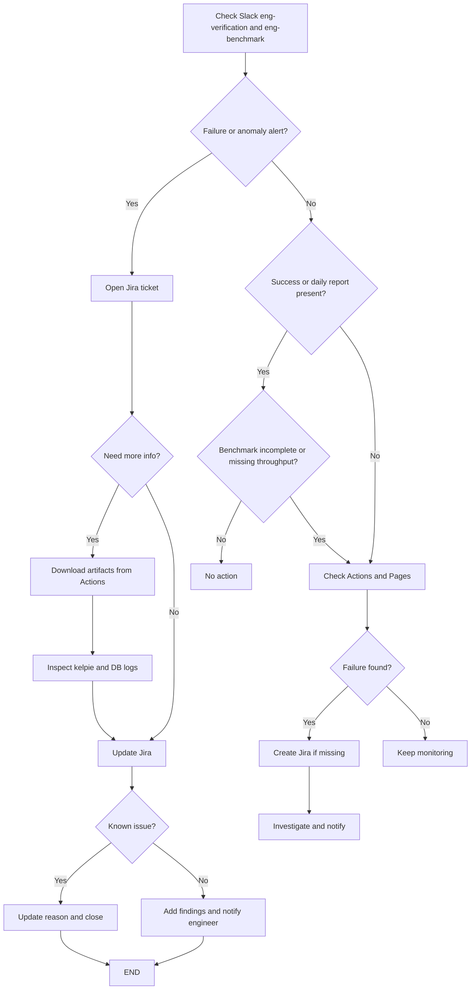

# Daily Test Monitoring & Failure Handling SOP

Quick daily checklist for Kelpie tests in this repository.

| Related docs | |
|--------------|---|
| Environments / how tests run | [test-environment-and-setup.md](./test-environment-and-setup.md) |
| Jepsen (DB / DL / Cluster) | [scalar-jepsen daily SOP](https://github.com/scalar-labs/scalar-jepsen/blob/master/docs/daily-test-checks.md) |

**What this repo covers:** Kelpie ScalarDB verification (`phantom-write`, `write-skew`) and ScalarDB / ScalarDL benchmarks.  
**What scalar-jepsen covers:** Jepsen ScalarDB, ScalarDL, and Cluster dailies.

---

## 1. Daily Monitoring

1. Check Slack:
   * **`eng-verification`** — ScalarDB Kelpie verification summary (success / failed / timed out).
   * **`eng-benchmark`** — daily ScalarDB and ScalarDL benchmark reports. Also watch for a separate **anomaly** alert.
2. If Slack is quiet (no success/report and no failure), or something looks incomplete:
   * Open [GitHub Actions](https://github.com/scalar-labs/kelpie-test/actions)
   * Open [GitHub Pages](https://scalar-labs.github.io/kelpie-test/)

**When do the dailies run?** Sunday–Friday only (no Saturday). Times below are cron UTC and approx IST:

| Workflow | Cron (UTC) | Approx IST |
|----------|------------|------------|
| Daily DB verification | `0 14 * * 0-5` | 19:30 |
| Daily DB benchmark | `0 18 * * 0-5` | 23:30 |
| Daily DL benchmark | `0 19 * * 0-5` | 00:30 next day |

Each run uses a temporary GitHub-hosted runner (Docker). There is nothing to SSH into or destroy in Azure after the job ends.

**Manual (`workflow_dispatch`) runs:** Slack, Jira, and Pages updates are **skipped**. Check the Actions run and artifacts yourself.

---

## 2. Failure Handling (Slack Alert Present)

### Verification (`eng-verification`)

1. Open the **Jira** ticket (project **`DLT`**). It should include the Actions run URL and log artifact name (`verification-logs-<test>`).
2. If you need more detail, download from the run:
   * `verification-logs-<test>` — `kelpie.log` plus Cassandra logs
   * `result-<test>` — `success` / `failure` / `timeout`
3. Update the ticket:
   * **Known issue** → write the reason → close (the Docker cluster is already torn down).
   * **New issue** → add findings → notify the right engineer(s) → suggest a fix if you have one → wait for confirmation.

### Benchmark (`eng-benchmark`)

* A normal daily **report** in Slack is expected even when things are healthy. That alone is not a failure.
* An **anomaly** alert (and usually a Jira ticket) means throughput at concurrency **16** left the 14-day 3σ band. Check the ticket, the Pages dashboard, and the `benchmark-results` or `dl-benchmark-results` artifact (`summary.csv`, logs, plots).
* Important: if Kelpie fails during the concurrency sweep, the workflow **logs** it but **does not fail the job** and **does not open Jira**. If the report looks empty or the job summary shows failed concurrencies, treat that as a failure: download artifacts and create a Jira ticket if none exists.

---

## 3. Failure Handling (No Slack Alert / No Ticket)

Use this when Actions shows a problem but Slack/Jira did not:

1. Open the Actions run (build, compose, schema-loader, or ledger startup often fail here).
2. Create a Jira ticket in **`DLT`** with the run URL and findings.
3. Download artifacts if present.
4. Notify the relevant engineer(s) and follow up.

This is also the normal path for **manual** runs and for **benchmark Kelpie exit failures** (see above).

---

## 4. Workflow Diagram

---

## 5. More detail

* Environments and schedules: [test-environment-and-setup.md](./test-environment-and-setup.md)
* Jepsen dailies: [scalar-jepsen daily SOP](https://github.com/scalar-labs/scalar-jepsen/blob/master/docs/daily-test-checks.md)
